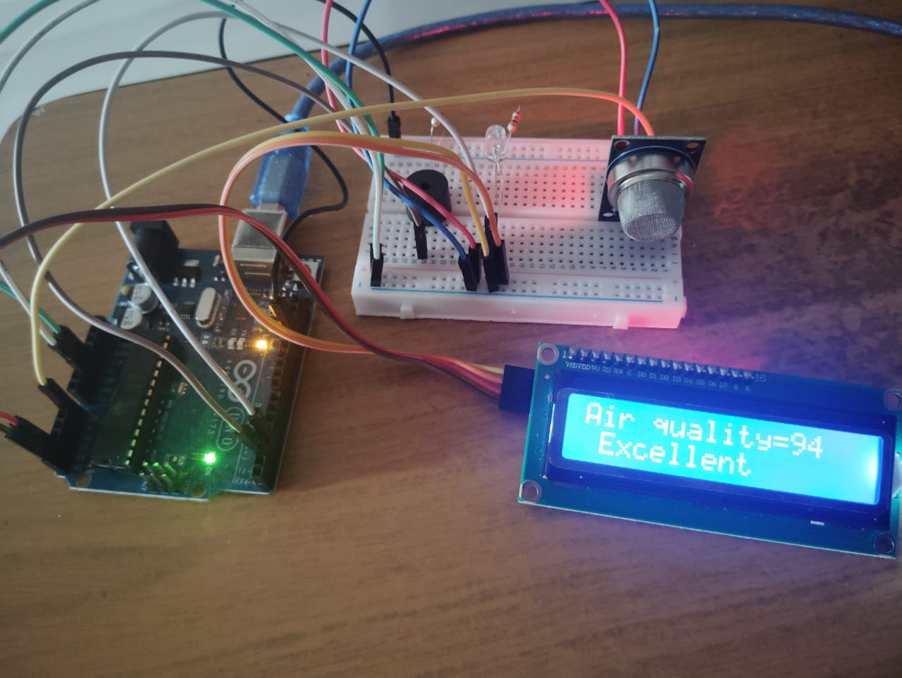

# Air Quality Monitoring System using MQ135 Sensor

## Overview

The **Air Quality Monitoring System** is an Arduino-based embedded electronics project designed to monitor changes in surrounding air quality using the MQ135 gas sensor.

The system continuously reads analog sensor values, processes them using an Arduino Uno, and displays the corresponding air-quality category on a 16x2 I2C LCD. An LED and buzzer provide visual and audible alerts when the sensor reading exceeds predefined pollution thresholds.

The project aims to provide an affordable and easy-to-use solution for basic environmental monitoring and pollution awareness.

## Project Prototype

*Working prototype showing the MQ135 sensor, Arduino Uno, LCD display, and alert components.*

## Key Features

- **Real-Time Monitoring:** Continuously reads analog signals from the MQ135 gas sensor.
- **Air Quality Classification:** Categorizes sensor readings into six levels: Excellent, Good, Moderate, Poor, Harmful, and Dangerous.
- **LCD Display:** Displays the numerical sensor reading and corresponding air-quality category.
- **Alert Mechanism:** Activates an LED and buzzer when the sensor reading exceeds the defined threshold.
- **Serial Monitoring:** Sends sensor readings to the Arduino Serial Monitor for observation and debugging.
- **Low-Cost Implementation:** Uses readily available electronic components.

## Hardware Components

| Component | Purpose |
|---|---|
| Arduino Uno | Processes sensor data and controls outputs |
| MQ135 Gas Sensor | Detects changes in the surrounding gas environment |
| 16x2 I2C LCD | Displays sensor readings and air-quality status |
| Buzzer | Provides an audible pollution alert |
| LED | Provides a visual pollution alert |
| Resistors | Provides current limiting and circuit protection |
| Breadboard and Jumper Wires | Circuit assembly and connections |

## Software and Technologies

- Embedded C/C++ (Arduino Programming)
- Arduino IDE
- Arduino Uno
- MQ135 Gas Sensor
- I2C LCD Interface
- Analog-to-Digital Conversion (ADC)

## Working Principle

The system operates through three main stages:

**1. Sensing**

The MQ135 gas sensor detects changes in the surrounding air and produces a corresponding analog output voltage.

**2. Processing**

The Arduino Uno reads the sensor's analog output through pin A0 using its built-in ADC. The resulting digital reading is processed using predefined conditional statements to determine the air-quality category.

**3. Display and Alert**

The processed sensor reading and its corresponding category are displayed on the LCD. When the reading exceeds the predefined threshold of 450, the Arduino activates the LED and buzzer to indicate a potentially poor air-quality condition.

## Air Quality Classification

The following thresholds are implemented in the Arduino program:

| Sensor Reading (ADC) | Air Quality | Alert |
|---|---|---|
| Below 100 | Excellent | OFF |
| 100–150 | Excellent | OFF |
| 151–250 | Good | OFF |
| 251–450 | Moderate | OFF |
| 451–700 | Poor | ON |
| 701–999 | Harmful | ON |
| 1000–1023 | Dangerous | ON |

*Note: These are project-specific thresholds applied to raw ADC readings, not official AQI breakpoints.*

## Circuit Connections

| Module | Arduino Uno |
|---|---|
| MQ135 Analog Output | A0 |
| LCD SDA | A4 |
| LCD SCL | A5 |
| LCD VCC | 5V |
| LCD GND | GND |
| Alert Output 1 | Digital Pin 2 |
| Alert Output 2 | Digital Pin 3 |

The LCD uses the I2C address `0x27`.

*Verify the buzzer and LED pin assignments against your actual circuit before wiring.*

## Project Results

The prototype was successfully implemented and tested.

During testing, the LCD displayed a sensor reading of **94**, classified as **Excellent**. The system also implements an LED and buzzer alert when the sensor reading exceeds the configured pollution threshold.

The prototype demonstrates real-time sensor interfacing, analog data acquisition, embedded programming, LCD communication, and alert generation.

## How to Run the Project

1. Assemble the circuit according to the connection details.
2. Install the Arduino IDE.
3. Install the `LiquidCrystal_I2C` library.
4. Connect the Arduino Uno to your computer through USB.
5. Open `air_quality_monitor.ino` in Arduino IDE.
6. Select the Arduino Uno board and the correct COM port.
7. Upload the program to the Arduino.
8. Allow the MQ135 sensor to warm up and stabilize.
9. Observe the sensor readings and air-quality classification on the LCD.
10. Test the alert mechanism by exposing the sensor to an appropriate test environment.

## Applications

- Basic indoor air-quality awareness.
- Educational environmental monitoring projects.
- Demonstration of gas sensor interfacing.
- Localized pollution monitoring experiments.
- Embedded systems and IoT learning applications.

## Limitations

- MQ135 is a broad-response gas sensor and cannot independently identify individual gases.
- Sensor readings are affected by temperature, humidity, warm-up time, and calibration.
- The current implementation displays raw ADC values rather than calibrated pollutant concentrations or official AQI.
- The predefined classification thresholds are intended for prototype demonstration, not medical or regulatory decisions.

## Future Enhancements

- Integrate Wi-Fi using ESP8266 or ESP32 for remote monitoring.
- Implement cloud-based data logging and visualization.
- Add temperature and humidity monitoring.
- Integrate dedicated PM2.5 and PM10 sensors.
- Develop a calibrated air-quality measurement system.
- Design a compact enclosure for long-term deployment.

